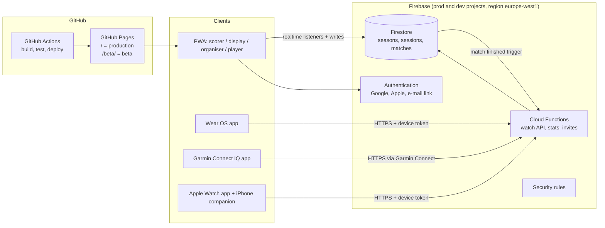

# Architecture: from scoreboard to club platform

Status: proposal (October 2026). Production is **v28** (branch `release/v28`); everything below is
built and tested in the beta first.

## 1. Goals

- Score with one click, as today, from a phone, a remote, earbuds or a **dedicated watch app**.
- Every screen (phone, tablet, TV) shows the **live** state of a match; several screens at once,
  and screens that follow **all courts** of a session.
- Seasons with sessions (training evenings), players, roles and invitations.
- Matchmaking for 12–13 players on 2+ courts: fair rotation, balanced teams, still random.
- Statistics and leaderboards per session and per season.
- Sign in with Google, Apple or an e-mail link. Works with a patchy sports-hall connection.
- Production stays stable while new versions are tested.

## 2. Overview



Key idea: **the database is the single source of truth.** A scorer (phone, remote, watch) only
*adds events* to a match; every screen just shows the latest state it receives. A screen that
loses its connection catches up automatically.

## 3. Environments and releases

| Environment | Code branch | Web address | Firebase project | Purpose |
|---|---|---|---|---|
| Production | `main` (v28 frozen in `release/v28`) | `…/badminton-score/` | `badminton-prod` | What the club uses |
| Beta | `develop` | `…/badminton-score/beta/` | `badminton-dev` | Testing new versions with real phones |
| Local | any | `localhost` | Firebase Emulator Suite | Development and automated tests |

- **GitHub Pages switches to "GitHub Actions" as its source.** One workflow builds `main` into the
  site root and `develop` into `/beta/`, then publishes both. (A branch-based Pages site can only
  serve one branch.)
- **Beta is fully separated from production** on the same domain:
  - its own service worker scope (`/beta/`) and cache names (`badminton-score-beta-…`); today's
    production worker deletes every cache that isn't its own, so cache names must be prefixed;
  - its own storage keys (`badminton-score-beta-…`), so testing never touches production scores;
  - its own manifest (`id`, name "Badminton Score β", a beta badge on the icon), so both can be
    installed side by side;
  - its own Firebase project, so test data never mixes with the season's real results.
- **Release:** merge `develop` into `main` when beta has been tested, bump the version, keep a
  `release/vNN` branch per release for a quick rollback.

## 4. Front-end

The single PWA gets four **modes** (one app, chosen per device):

| Mode | Who | What |
|---|---|---|
| Scorer | Phone at a court | Today's scoreboard, bound to a court; remote, earbuds, taps |
| Display | Tablet / TV / spare phone | Read-only, large; one court, or a grid of all courts |
| Organiser | Session manager | Attendance, courts, queue, next matches (automatic or drag & drop) |
| Player | Everyone | Live courts, my waiting time, my stats, leaderboard |

Technology:

- **Build step with Vite**, run by GitHub Actions. Today's app is plain files; with Firebase,
  several screens and charts, a build step keeps it maintainable and loads only what each mode
  needs.
- **Keep the scoring core framework-free.** `match.js`, `random.js` and the matchmaking module stay
  plain, tested JavaScript, shared by the PWA and the Cloud Functions, so the server applies
  exactly the same rules as the phones.
- **UI:** small components (Lit or Preact) for the new screens; the existing scoreboard is kept as
  it is.
- **Charts:** a small charting library (e.g. uPlot or Chart.js) for progress graphs.
- **Offline:** Firestore's offline persistence; scores are queued and synced when the connection is
  back.

## 5. Data model (Firestore)

```
users/{uid}                     name, photo, linked playerId per season
seasons/{seasonId}              name, start, end, defaults (points, format)
  members/{uid}                 role: owner | admin | scorer | member
  invites/{token}               role, expiry, created by (link and QR code)
  players/{playerId}            display name, uid (optional: guests have none), rating
  sessions/{sessionId}          date, courts (changeable during the session), format:
                                1v1 | 2v2 | mixed, status
    attendance/{playerId}       present | expected | left, arrived at
    queue                       derived: waiting order, games played tonight
    matches/{matchId}           court, teams [[ids],[ids]], rules, server, sides,
                                status: planned | live | finished, startedAt, endedAt
      events/{eventId}          point(team) | undo | sides | start | end,
                                at (server time), by (uid or device), clientId
  stats/…                       derived per player, pair, session, season (by Cloud Functions)
devices/{deviceId}              paired watch: owner uid, season, allowed courts, token hash
```

- **Event log per match:** each point is a separate event with a unique `clientId`. Two scorers
  pressing at the same time can't overwrite each other, a repeated send (a watch retrying) is
  recognised by its `clientId` and counted once, and an undo is an event too. The score itself is
  calculated from the events with `match.js`, the same code as today.
- **One player, one match:** starting a match uses a Firestore transaction that checks no listed
  player is in another live match.
- **Guests:** a player doesn't need an account. Someone who signs in later can claim their guest
  player, keeping their history.

## 6. Accounts, roles and sharing

- **Sign-in:** Google (free), e-mail link (free), Apple (needs a paid Apple Developer account,
  also for the web). Firebase Authentication handles all three.
- **Roles per season:**

  | Role | Can |
  |---|---|
  | Owner | Everything, including deleting the season and changing owners |
  | Admin | Manage sessions, courts, players, matches; invite; give scorer/admin rights |
  | Scorer | Start and score matches on a court |
  | Member | View everything; check in; see own stats |

- **Sharing:** an invite link or QR code (WhatsApp, or on screen) carries a one-time or expiring
  token; opening it and signing in adds you to the season with the role in the invite. A display
  screen can follow a session **without signing in** through a read-only share link, if the owner
  enables that.
- **Enforcement:** Firestore security rules check every read and write against the member's role;
  the rules have their own automated tests in the emulator.

## 7. Matchmaking (rotation and balance)

For each free court, the organiser's device proposes the next match:

1. **Who plays:** present players not in a live match, longest waiting first (fewest games
   tonight, then longest since their last game).
2. **Format:** 2v2 when four are available and the session allows doubles; otherwise 1v1.
3. **Teams:** score many possible splits on *balance* (difference in team rating), *variety*
   (penalty for repeating partners and opponents tonight) and *fairness*; pick at random among the
   best few, using the secure random generator (`random.js`).
4. **Override:** the organiser can swap or drag players before starting, in a few taps.
5. **Waiting time:** the queue position times tonight's average match duration (measured live).

## 8. Statistics

Calculated from the match events by a Cloud Function when a match finishes, and stored as
summaries, so screens load instantly.

- **Rating:** OpenSkill (open source, MIT), a TrueSkill-like rating that handles doubles with
  rotating partners and gives new players a fast start. It drives both the balance in matchmaking
  and the leaderboard.
- **Player:** matches, wins, losses, win %, games, points for/against, service points won %,
  longest point streak, comebacks, game/match points converted and saved, rating over time
  (chart).
- **Pairs and head-to-head:** best partnerships, results between players or pairs.
- **Session:** winner of the evening, matches played, longest/closest match, biggest win.
- **Season:** leaderboard (rating and win % with a minimum number of matches), records, attendance.
- **Note on "longest rally":** the app knows who won a rally, not how many shots it had. It can
  measure the **longest time between two points** (a proxy that includes pauses), the longest
  point streak and the longest game exactly.

## 9. Watch apps

All three talk to the same small **watch API** (Cloud Functions): `pair`, `current match`,
`point`, `undo`. The watch only sends events and shows the score it gets back.

- **Pairing:** the watch shows a 6-character code; an admin enters it in the PWA, which gives the
  watch a token limited to that season (and optionally one court). No password on the watch.
- **Repeats:** every press carries a unique id, so retries never count twice.

| Watch | Technology | Distribution | Cost |
|---|---|---|---|
| Wear OS | Kotlin, Compose for Wear OS, standalone (own Wi-Fi/LTE or via phone) | Google Play | €25 once |
| Garmin | Connect IQ (Monkey C); internet via the Garmin Connect app on the phone | Connect IQ Store | free |
| Apple Watch | SwiftUI watchOS app, which must ship inside an iPhone app | App Store / TestFlight | ~€99 per year |

Until these exist, the current **Headphone controls** already let a watch's music buttons score.

## 10. Costs (estimate for one club)

- GitHub Pages and Actions: free.
- Firebase: Cloud Functions need the pay-as-you-go **Blaze** plan; at this size usage stays within
  the free quota (about 50 000 reads per day free; one evening is a few thousand). A budget alert
  of a few euros guards against surprises.
- Apple Developer Program: ~€99 per year (Sign in with Apple and the Apple Watch app).
- Google Play developer account: €25 once (Wear OS app). Garmin: free.

## 11. Privacy

- Data stored in the EU (`europe-west1`); only names, optional photos and results.
- Players can be guests without an account; members can delete their account and data.
- Display share links are read-only and can be revoked.
