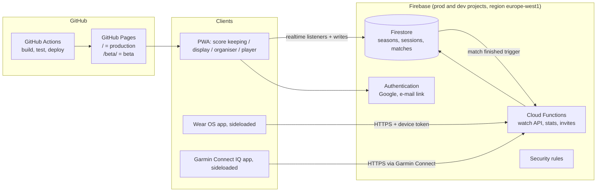

# Architecture: from scoreboard to club platform

Status: proposal (October 2026). Production is **v28** (branch `release/v28`); everything below is
built and tested in the beta first.

## 1. Goals

- Score with one click, as today, from a phone, a remote, earbuds or a **dedicated watch app**
  (Garmin and Wear OS; no Apple Watch, see section 9).
- **Every match is fully recorded**: every score update and every correction, with the **score
  keeper** who entered it (a player or someone next to the court) and the device used. The keeper
  can change during a match; each match keeps its list of keepers.
- Every screen (phone, tablet, TV) shows the **live** state of a match; several screens at once,
  and screens that follow **all courts** of a session.
- Seasons with sessions (training evenings), players, roles and invitations.
- Matchmaking for 12–13 players on 2+ courts: fair rotation, balanced teams, still random.
- Statistics and leaderboards per session and per season.
- Sign in with Google or an e-mail link (works on iPhone too). Works with a patchy sports-hall
  connection.
- Production stays stable while new versions are tested.

## 2. Overview



Key idea: **the database is the single source of truth.** A score keeper (phone, remote, watch) only
*adds events* to a match; every screen just shows the latest state it receives. A screen that
loses its connection catches up automatically.

## 3. Environments and releases

| Environment | Code branch | Web address | Firebase project | Purpose |
|---|---|---|---|---|
| Production | `main`, site root (v28; also frozen in branch `release/v28`) | `…/badminton-score/` | `badminton-prod` | What the club uses |
| Beta | `main`, folder `beta/` (v29) | `…/badminton-score/beta/` | `badminton-dev` | Testing new versions with real phones |
| Local | any | `localhost` | Firebase Emulator Suite | Development and automated tests |

- **Both live in `main`:** production in the site root, the beta in the `beta/` folder; GitHub
  Pages serves the folder at `/beta/` without any settings change. Once the app gets a build step
  (phase 1), a GitHub Actions workflow builds the beta into `beta/`, or Pages switches to "GitHub
  Actions" as its source.
- **Beta is fully separated from production** on the same domain:
  - its own service worker scope (`/beta/`) and cache names (`badminton-score-beta-…`), and it only
    cleans up its own caches; v28 deletes other caches only when production itself updates, after
    which the beta simply re-caches;
  - its own storage keys (`badminton-score-beta-…`), so testing never touches production scores;
  - its own manifest (`id`, name "Badminton Score β", a beta badge on the icon), so both can be
    installed side by side;
  - its own Firebase project, so test data never mixes with the season's real results.
- **Release:** when the beta has been tested, copy `beta/` over the site root with production's
  names (storage key, cache prefix, manifest, no β), bump the version, and keep a `release/vNN`
  branch per release for a quick rollback.

## 4. Front-end

The single PWA gets four **modes** (one app, chosen per device):

| Mode | Who | What |
|---|---|---|
| Score keeping | Phone at a court | Today's scoreboard, bound to a court; remote, earbuds, taps |
| Display | Tablet / TV / spare phone | Read-only, large; one court, or a grid of all courts |
| Organiser | Session manager | Attendance, courts, queue, next matches (automatic or drag & drop) |
| Player | Everyone | Live courts, my waiting time, my stats, leaderboard |

Technology:

- **Build step with Vite**, run by GitHub Actions. Today's app is plain files; with Firebase,
  several screens and charts, a build step keeps it maintainable and loads only what each mode
  needs.
- **Keep the scoring core framework-free.** `match.js`, `random.js` and the matchmaking module stay
  plain, tested JavaScript, shared by the PWA and the Cloud Functions, so the server applies
  exactly the same rules as the phones.
- **UI:** small components (Lit or Preact) for the new screens; the existing scoreboard is kept as
  it is.
- **Charts:** a small charting library (e.g. uPlot or Chart.js) for progress graphs.
- **Offline:** Firestore's offline persistence; scores are queued and synced when the connection is
  back.

## 5. Data model (Firestore)

```
users/{uid}                     name, photo, linked playerId per season
seasons/{seasonId}              name, start, end, defaults (points, format)
  members/{uid}                 role: owner | admin | keeper | member
  invites/{token}               role, expiry, created by (link and QR code)
  players/{playerId}            display name, uid (optional: guests have none), rating
  sessions/{sessionId}          date, courts (changeable during the session), format:
                                1v1 | 2v2 | mixed, status
    attendance/{playerId}       present | expected | left, arrived at
    queue                       derived: waiting order, games played tonight
    matches/{matchId}           court, teams [[ids],[ids]], rules, server, sides,
                                status: planned | live | finished, startedAt, endedAt
      events/{eventId}          see "Match events and score keepers" below
    (match).keepers             summary per keeper: updates, corrections, first/last update
  keepers/{keeperId}            name, uid (optional: a keeper without an account has none)
  stats/…                       derived per player, pair, session, season (by Cloud Functions)
devices/{deviceId}              paired watch: owner uid, season, allowed courts, token hash
```

### Match events and score keepers

Every change to a match is an event; nothing is overwritten or deleted, so the full history of
every match is kept.

The **score keeper** is the person entering the score: a player with a remote, someone next to the
court with the phone or a watch. The app records **who entered each update**, not which player won
the rally: a point belongs to a team, not to a player.

| Field | Meaning |
|---|---|
| `id` | unique per event, created on the device (`clientId`): a resent event counts once |
| `type` | `point`, `undo`, `sides`, `start`, `end`, `fix` |
| `team` | for `point`: the team that won the rally (0 or 1) |
| `undoes` | for `undo` and `fix`: the id of the update it corrects |
| `keeper` | who entered this update: a member (`uid`) or a keeper without an account (`keeperId`) |
| `device` | phone, Garmin or Wear OS watch, with a device id |
| `input` | tap, remote, earbuds/headphones, watch, screen-as-remote |
| `at`, `clientAt` | server time and the device's own time (for offline scoring) |
| `reason` | for `fix`: an admin's correction after the match, with a short note |

- **Keeper changes during a match:** the scoring phone shows who is keeping score; one tap hands
  over to someone else (a member, or a name from the keeper list for people without an account).
  A paired watch always belongs to one person. Several keepers can even work at the same time
  (a remote on court and a watch next to it); every update carries its own keeper.
- **Keeper list per match:** each match keeps a summary of everyone who entered updates, in order:
  name, first and last update, number of updates, and number of corrections. It is derived from
  the events, so it can never disagree with them.
- **Corrections are kept:** an undo doesn't delete the update; it is a new event that points to the
  update it cancels. The score counts only updates that weren't cancelled, and the statistics see
  every correction and whose update it corrected.

- **Event log per match:** each point is a separate event with a unique `clientId`. Two keepers
  pressing at the same time can't overwrite each other, a repeated send (a watch retrying) is
  recognised by its `clientId` and counted once, and an undo is an event too. The score itself is
  calculated from the events with `match.js`, the same code as today.
- **One player, one match:** starting a match uses a Firestore transaction that checks no listed
  player is in another live match.
- **Guests:** a player doesn't need an account. Someone who signs in later can claim their guest
  player, keeping their history.

## 6. Accounts, roles and sharing

- **Sign-in:** Google and e-mail link, both free, handled by Firebase Authentication. iPhone users
  use either one. Sign in with Apple is left out: it needs the paid Apple Developer Program, also
  on the web.
- **Roles per season:**

  | Role | Can |
  |---|---|
  | Owner | Everything, including deleting the season and changing owners |
  | Admin | Manage sessions, courts, players, matches; invite; give keeper/admin rights |
  | Score keeper | Start matches and enter scores on a court (players and non-players) |
  | Member | View everything; check in; see own stats |

- **Sharing:** an invite link or QR code (WhatsApp, or on screen) carries a one-time or expiring
  token; opening it and signing in adds you to the season with the role in the invite. A display
  screen can follow a session **without signing in** through a read-only share link, if the owner
  enables that.
- **Enforcement:** Firestore security rules check every read and write against the member's role;
  the rules have their own automated tests in the emulator.

## 7. Matchmaking (rotation and balance)

For each free court, the organiser's device proposes the next match:

1. **Who plays:** present players not in a live match, longest waiting first (fewest games
   tonight, then longest since their last game).
2. **Format:** 2v2 when four are available and the session allows doubles; otherwise 1v1.
3. **Teams:** score many possible splits on *balance* (difference in team rating), *variety*
   (penalty for repeating partners and opponents tonight) and *fairness*; pick at random among the
   best few, using the secure random generator (`random.js`).
4. **Override:** the organiser can swap or drag players before starting, in a few taps.
5. **Waiting time:** the queue position times tonight's average match duration (measured live).

## 8. Statistics

Calculated from the match events by a Cloud Function when a match finishes, and stored as
summaries, so screens load instantly.

- **Rating:** OpenSkill (open source, MIT), a TrueSkill-like rating that handles doubles with
  rotating partners and gives new players a fast start. It drives both the balance in matchmaking
  and the leaderboard.
- **Player:** matches, wins, losses, win %, games, points for/against, service points won %,
  longest point streak, comebacks, game/match points converted and saved, rating over time
  (chart).
- **Pairs and head-to-head:** best partnerships, results between players or pairs.
- **Session:** winner of the evening, matches played, longest/closest match, biggest win.
- **Season:** leaderboard (rating and win % with a minimum number of matches), records, attendance.
- **Score keepers:** per keeper, per session and per season: matches kept, **score updates
  entered**, **corrections** (their updates that were later undone or fixed, by themselves or
  someone else), and the **error rate** = corrections ÷ score updates. Also per input method (tap,
  remote, earbuds, watch), how quickly mistakes were corrected, and keeping score while playing
  versus from the side of the court. An undo is not always a mistake (a let or a changed line call
  also leads to one), so the error rate is an indication, not a verdict.
- **Note on "longest rally":** the app knows who won a rally, not how many shots it had. It can
  measure the **longest time between two points** (a proxy that includes pauses), the longest
  point streak and the longest game exactly.

## 9. Watch apps

Garmin and Wear OS only, both **sideloaded** (no public store listing). There is **no Apple Watch
app**: Apple only allows watch apps through TestFlight or the App Store, which both need the paid
Apple Developer Program. Apple Watch owners can still score with the watch's music buttons
(*Headphone controls*).

Both apps talk to the same small **watch API** (Cloud Functions): `pair`, `current match`,
`point`, `undo`. The watch only sends events and shows the score it gets back. Each event carries
the watch's keeper and device, like any other event.

- **Pairing:** the watch shows a 6-character code; an admin enters it in the PWA, which gives the
  watch a token limited to that season (and optionally one court). No password on the watch.
- **Repeats:** every press carries a unique id, so retries never count twice.

| Watch | Technology | Distribution (sideloaded) | Cost |
|---|---|---|---|
| Garmin | Connect IQ (Monkey C); internet via the Garmin Connect app on the phone | A `.prg` file per watch model, copied over USB to `GARMIN/APPS`; download page on the website | Free |
| Wear OS | Kotlin, Compose for Wear OS, standalone (own Wi-Fi/LTE or via the phone) | APK installed over Wi-Fi with an installer app (e.g. Wear Installer), signed by a verified "limited distribution" developer account so Android's developer verification (from 2027 everywhere) doesn't block it. Optional: a private Google Play test track for automatic updates | Free (Play test track: €25 once) |

## 10. Costs (estimate for one club)

- GitHub Pages and Actions: free.
- Firebase: Cloud Functions need the pay-as-you-go **Blaze** plan; at this size usage stays within
  the free quota (about 50 000 reads per day free; one evening is a few thousand). A budget alert
  of a few euros guards against surprises.
- No Apple costs: no Apple Watch app and no Sign in with Apple.
- Wear OS: free with a "limited distribution" developer account; €25 once only if you want the
  private Google Play test track. Garmin: free.

## 11. Privacy

- Data stored in the EU (`europe-west1`); only names, optional photos and results.
- Players can be guests without an account; members can delete their account and data.
- Display share links are read-only and can be revoked.
